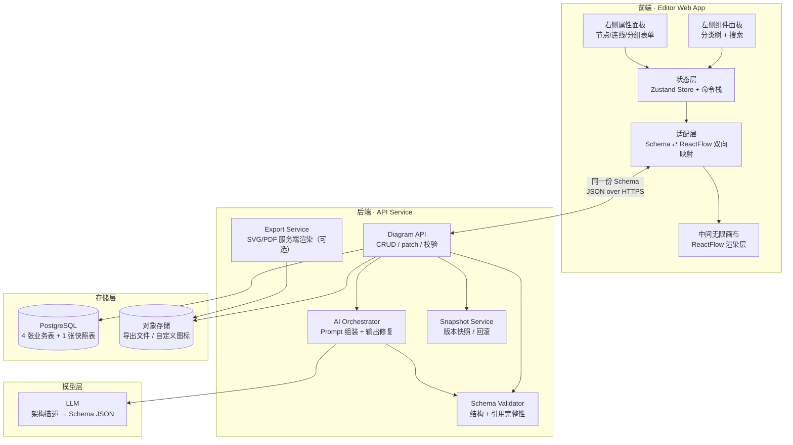
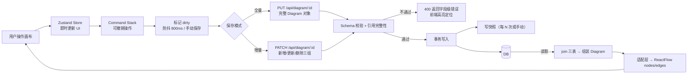
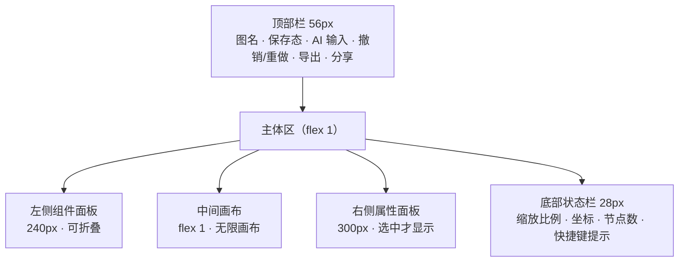
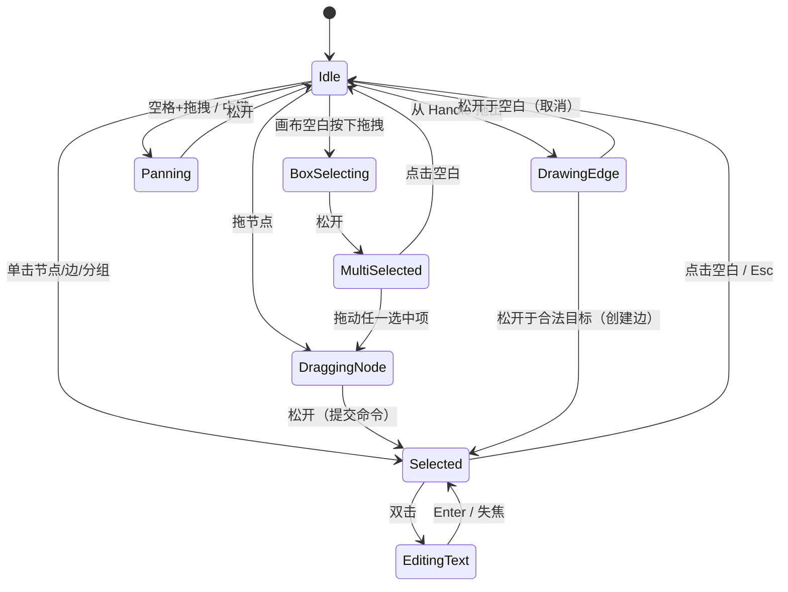
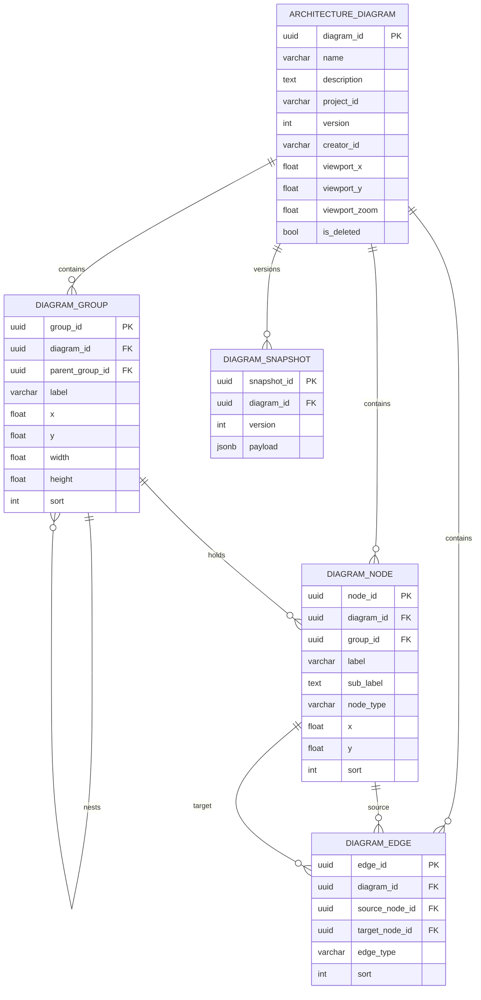
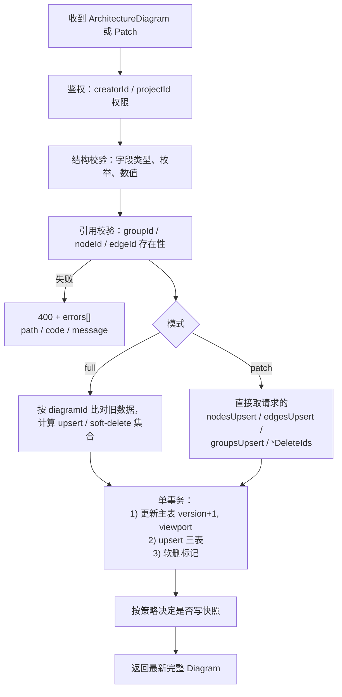
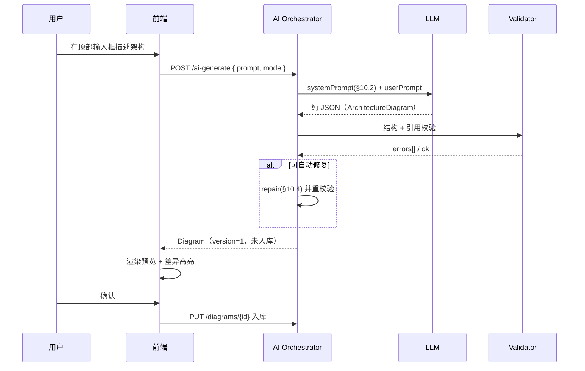

# 架构拓扑绘图工具 · 技术规格说明书

| 项 | 内容 |
|---|---|
| 文档名称 | 架构拓扑绘图工具技术规格（Architecture Diagram Studio Spec） |
| 版本 | v1.0 |
| 状态 | 待评审 / 可进入开发 |
| 编写日期 | 2026-11-04 |
| 交互范式参考 | n8n 工作流编辑器（左材质面板 / 中无限画布 / 右属性面板） |
| 能力对标 | Draw.io、Lucidchart（编辑深度）+ n8n（操作手感） |
| 核心特征 | **交互式可编辑画布**，非一次性出图；全链路共用一套持久化 Schema |

---

## 0. 文档说明

### 0.1 本文档解决什么问题

本工具要绘制的是**企业 IT 网络 / 云 / 容器架构拓扑图**（典型样图内容：互联网 → WAF → DMZ 区 VIP/反向代理 → 内网 Kubernetes 集群 → 数据库 / 第三方服务，并带 IP、端口、子网、分区泳道、跨区连线）。

样图不是一张静态图片，而是一份**结构化资产**：每个节点、每条连线、每个分区都要能被单独修改、查询、统计、入库。因此本文档把三件事统一到**同一套 Schema** 上：

1. 前端画布渲染与编辑；
2. AI 根据自然语言批量生成的初始拓扑；
3. 后端数据库的读写与版本快照。

**核心约束：一套 Schema 贯穿渲染、传输、入库、导入导出，任何环节不得做字段改名或结构嵌套转换。**

### 0.2 术语表

| 术语 | 含义 |
|---|---|
| Diagram | 一张架构图，对应一个 `diagram_id`，含 viewport、groups、nodes、edges |
| Group / 泳道 | 画布上的分区容器框（如 DMZ ZONE、INTRANET），可嵌套、可折叠 |
| Node | 画布上的单个组件卡片（WAF、VIP、Pod、MySQL…） |
| Edge | 两个 Node 之间的连线，带方向、颜色、标注、线型 |
| Anchor | 连线端点吸附位（top / bottom / left / right） |
| Viewport | 画布视口（x、y 偏移 + zoom 缩放） |
| Snapshot | 某个 version 的完整 JSON 快照，用于回滚与对比 |
| extJson | 扩展属性槽位（JSONB / JSON），不参与索引查询 |

### 0.3 阅读指引

- 只做前端 → 读 §3、§4、§5、§6、§11、§12
- 只做后端 / DBA → 读 §6、§7、§8、§9
- 只做 AI 生成链路 → 读 §6、§10
- 要一次性把提示词丢给 Cursor → 直接用 **附录 A**

---

## 1. 产品定位与目标

### 1.1 一句话定位

> 一个面向运维 / 架构 / 售前场景的**结构化架构拓扑编辑器**：像 n8n 一样拖拽连线，像 Draw.io 一样自由排版，产物是可入库、可检索、可版本化的 JSON 资产。

### 1.2 样图要素 → 能力映射

| 样图里的要素 | 工具必须提供的能力 | 落地章节 |
|---|---|---|
| DMZ ZONE / INTRANET 大分区框 | 泳道分组：命名、着色、缩放、整体拖动、嵌套、折叠 | §4.3 |
| 白色卡片节点（含名称 + IP + 端口多行小字） | 节点卡片：主标题 + 副文本多行、背景/边框/文字色 | §4.1 |
| 橙色外网流量 / 紫色内部调用 / 绿色集群流量的折线 | 连线：正交折线、语义配色、线宽、虚线、线上标注 | §4.2 |
| 节点之间的直角走线，尽量不压节点 | 自动正交路由 + 手动锚点锁定 | §11.3 |
| 全图 40+ 节点仍可读 | 图层、缩放、小地图、搜索定位 | §4.4 / §4.7 |
| 图要能进汇报材料 | 导出 PNG / SVG / PDF | §12 |
| 图要能持续维护、能对比历史 | 版本快照 + 完整 JSON 导出导入 | §7.5 / §8 |

### 1.3 目标（In Scope）

- 三栏式编辑器，节点 / 连线 / 分组的完整增删改查。
- 画布数据以统一 Schema 落库，支持全量保存与增量保存。
- AI 输入框：一段业务描述 → 结构化拓扑 JSON → 直接入库并渲染。
- 导出图片类与工程文件类产物。

### 1.4 非目标（Out of Scope，v1.0 明确不做）

- 不做图片生成器（不允许"生成一张图就完事、无法再编辑"的交付形态）。
- 不做 3D、阴影、渐变质感等装饰性效果。
- 不做多人实时协同光标（v2 再评估，见 §13）。
- 不做自动网络探测 / 从 CMDB 发现节点（v2 可作为数据源接入）。
- 不做 UML / 流程图 / 思维导图等其他图种（只做架构拓扑）。

---

## 2. 系统架构

### 2.1 分层结构



### 2.2 关键设计决策

| 决策 | 选择 | 理由 |
|---|---|---|
| 画布库 | ReactFlow 12 | 原生支持自定义节点、Handle 锚点、Edge 类型、viewport、MiniMap；省掉自研命中测试与连线交互 |
| 分组实现 | 自定义 GroupNode + `parentId`（ReactFlow 12 `parentId` / 旧版 `parentNode`） | 子节点坐标走相对父节点，拖动父框自动带动子节点，无需手写联动 |
| 连线默认类型 | 自定义 `ortho` 边（正交折线） | 样图全部是直角折线，默认 bezier 不符合视觉 |
| 持久化结构 | 扁平三表（group / node / edge）+ 主表 | 位置、样式字段要能被 SQL 直接查询与聚合，禁止塞进单个大 JSON 字段 |
| 扩展字段 | `ext_json`（PG 用 JSONB） | 兼顾灵活性与可查询性；核心字段一律平铺 |
| AI 输出 | 严格对齐 Schema 的纯 JSON | 后端 `JSON.parse` 即可入库，零映射层；失败可自动修复 |
| 保存模式 | 全量覆盖（默认）+ 增量 patch（大图 / 自动保存） | 大图（>300 节点）全量提交体积过大，需要 patch |

### 2.3 端到端数据流



---

## 3. UI 布局规范（n8n 范式）

### 3.1 整体骨架



### 3.2 区域规格表

| 区域 | 宽度 / 高度 | 内容 | 关键交互 |
|---|---|---|---|
| 顶部栏 | 高 56px，固定 | 图名（可双击改名）、保存状态徽标（已保存/保存中/未保存）、AI 输入框（单行，回车生成）、撤销、重做、导出下拉、分享 | AI 输入框获得焦点时顶部栏轻微抬起（阴影） |
| 左侧面板 | 宽 240px，可折叠至 0 | 分类树（9 大类）+ 顶部搜索框 + 底部"自定义图标上传" | 拖拽到画布生成节点；双击自动放到视口中心 |
| 中间画布 | 自适应，最小 400px | 无限网格画布、MiniMap（右下，160×110）、缩放控件（左下） | 滚轮缩放 / 空格拖拽平移 / 框选 |
| 右侧面板 | 宽 300px，无选中时收起 | 选中对象的属性表单、图层排序、锁定、删除 | 输入即改，改完 800ms 防抖落库 |
| 底部状态栏 | 高 28px | 缩放 %、光标坐标、节点/连线数量、当前快捷键方案 | 可点击缩放 % 复位到 100% |

### 3.3 左侧组件分类树（组件枚举）

| 分类 | 组件 | nodeType |
|---|---|---|
| 网络安全 | 防火墙、WAF、VIP、负载均衡、VPN 网关、IDS/IPS | `firewall` `waf` `vip` `lb` `vpn` `ids` |
| 计算 | 物理服务器、虚拟机、容器、Nginx、反向代理 | `server` `vm` `container` `nginx` `proxy` |
| 容器编排 | K8s Cluster、Namespace、Deployment、Service、Pod、Ingress | `k8s-cluster` `namespace` `deployment` `service` `pod` `ingress` |
| 存储 / 数据 | MySQL、PostgreSQL、Redis、MongoDB、Kafka、RabbitMQ、对象存储 | `db` `cache` `mq` `oss` |
| 中间件 / 网关 | API 网关、消息网关、配置中心 | `gateway` |
| 外部服务 | 互联网用户、第三方支付、CDN、短信、OAuth、外部 API | `external` |
| 网络设备 | 交换机、路由器、专线、子网 | `switch` `router` `link` `subnet` |
| 结构件 | 分组泳道、区域框、注释文本、图例 | `group` `zone` `text` `legend` |
| 自定义 | 上传自定义图标 / 纯色卡片 | `custom` |

> 完整图标清单见 **附录 B**。`custom` 允许携带 `extJson.iconUrl`。

### 3.4 视觉 Token

| Token | 值 | 用途 |
|---|---|---|
| `--canvas-bg` | `#FAFAFA` | 画布底色 |
| `--grid-line` | `#E8EAED`，20px 网格（缩放联动） | 网格 |
| `--panel-bg` | `#FFFFFF` | 三栏面板 |
| `--panel-border` | `#E5E7EB` | 面板分割线 |
| `--primary` | `#2563EB` | 选中框、主要按钮 |
| `--selection-ring` | `#2563EB` 2px + 8% 外发光 | 选中态 |
| `--text-primary` | `#111827` | 节点标题 |
| `--text-secondary` | `#6B7280` | IP / 端口副文本 |
| `--node-bg` | `#FFFFFF` | 节点卡片底 |
| `--node-border` | `#D1D5DB` | 节点边框 1px |
| `--radius-node` | 8px | 节点圆角 |
| `--shadow-none` | — | **禁止阴影** |
| 字体 | UI：`Inter, system-ui`；IP/端口：`JetBrains Mono, ui-monospace` | 双字体体系 |

### 3.5 语义色（连线与分区）

| 语义 | 颜色 | 线宽 | 使用场景 |
|---|---|---|---|
| 外网 / 互联网流量 | `#F59E0B`（橙） | 2px | 互联网 → WAF → DMZ |
| 内部服务调用 | `#8B5CF6`（紫） | 1.5px | 服务间 RPC / HTTP |
| 集群内部流量 | `#10B981`（绿） | 1.5px | Pod ↔ Service ↔ DB |
| 管理 / 运维通道 | `#64748B`（灰）虚线 `4,4` | 1px | 监控、跳板、备份 |
| 分区底色 | DMZ `#F1F3F5` / INTRANET `#EFF6FF` / EXTERNAL `#FFF7ED` | — | 泳道背景 |
| 分区边框 | 对应底色加深 20%，1px | — | 泳道描边 |

---

## 4. 画布核心交互

### 4.1 节点操作

| 动作 | 触发 | 结果 | 快捷键 |
|---|---|---|---|
| 新增 | 从左侧面板拖入 / 右键菜单 / AI 生成 | 在落点创建，默认尺寸 160×80，自动选中并聚焦属性面板 | `N` |
| 单选 | 左键单击 | 显示选中框 + 8 个 resize 手柄 + 4 个连接 Handle | — |
| 多选 | 框选 / `Shift`+点击 / `Ctrl`+点击 | 显示多选包围盒，属性面板切换为"批量"模式 | — |
| 移动 | 拖拽节点主体 | 位置更新；属于分组的节点随父框移动；连线实时跟随 | 方向键微调 1px / `Shift`+方向 10px |
| 尺寸 | 拖拽 resize 手柄 | width/height 更新；内部文字自动重排 | — |
| 复制 | `Ctrl+C` / `Ctrl+D` | 生成新 nodeId，偏移 (24,24)，**同组内连线的两端若都在复制集合内则一并复制** | — |
| 删除 | `Delete` / 右键删除 | 删除节点 + 级联删除挂在其上的 edges（含他人指向它的边） | — |
| 编辑文本 | 双击 / 右侧面板 | 进入行内编辑：主标题（Enter 提交）、副文本（多行，支持 `\n`、`:` 分隔 IP:PORT） | — |
| 锁定 | 属性面板 / 右键 | `locked=true`，不可拖动与 resize，但仍可连线、可选中 | `L` |
| 隐藏 | 属性面板 | `visible=false`，不渲染但仍存在数据中（导出时可选排除） | — |
| 置顶 / 置底 | 右键 | 调整 `sort`，控制遮挡层级 | `]` / `[` |
| 对齐 | 多选后工具栏 | 左 / 右 / 上 / 下 / 水平居中 / 垂直居中 | — |
| 均匀分布 | 多选后工具栏 | 水平等距 / 垂直等距 | — |

**节点数据承载**：主标题 `label`（单行，超长省略并 tooltip）；副文本 `subLabel`（最多 4 行小字，等宽字体，展示 `10.0.1.21:8080` 这类内容）。

### 4.2 连线操作

| 动作 | 触发 | 结果 |
|---|---|---|
| 建线 | 从节点任一侧 Handle 按下拖到目标节点 Handle / 节点体 | 生成 edge，默认 `ortho`、`#8B5CF6`、1.5px |
| 反向建线 | 从目标拖回源 | 允许，方向以拖拽起止为准 |
| 端点重连 | 拖动 edge 端点 | 更新 sourceNodeId / targetNodeId / anchor |
| 断点吸附 | 拖拽结束时 | 距节点 12px 内自动吸附到最近 Handle |
| 线型切换 | 属性面板 | `ortho`（直角，默认）/ `bezier` / `straight` |
| 样式 | 属性面板 | 颜色（语义色板 + 取色器）、线宽（1 / 1.5 / 2 / 3）、实线/虚线（预设 `4,4` `6,3`） |
| 标注 | 双击线 / 属性面板 | 线上居中白底标签，如 `443/TLS`、`主链路` |
| 箭头 | 属性面板 | 无箭头（默认，拓扑图习惯）/ 单向箭头 / 双向 |
| 删除 | 选中后 Delete | 仅删该边 |

**路由规则（`ortho`）**：优先水平或垂直出线（依据 anchor 方向），采用 1～2 个中间拐点的正交折线；当两个节点矩形重叠投影时，自动绕行到最近的非重叠通道（算法见 §11.3）。

### 4.3 分组 / 泳道（重点能力）

| 动作 | 触发 | 结果 |
|---|---|---|
| 新建分组 | 左侧拖拽「分组框」/ 右键"添加分组" / 框选多个节点后"打包成分组" | 生成 group，尺寸自适应容纳成员 + 24px 内边距 |
| 命名 | 双击分组标题区 | 标题栏左上角文字，如 `DMZ ZONE` |
| 着色 | 属性面板 | 背景色（浅色板）、边框色、标题色 |
| 整体移动 | 拖拽分组标题栏（非节点区） | 组内所有节点（含嵌套子组）相对位移一致 |
| 缩放 | 拖拽分组边框手柄 | 仅改容器尺寸，不缩放内部节点（避免文字变形） |
| 加入 / 移出 | 把节点拖进分组范围 / 拖出 | 命中判定：节点中心点落在组内即加入，`groupId` 更新；坐标换算为相对父组 |
| 嵌套 | 把分组拖入另一分组 | `parentGroupId` 更新，最多 3 层 |
| 折叠 | 标题栏折叠按钮 | `collapsed=true`，隐藏子元素（节点与连线），容器缩为标题条高度，折叠状态持久化 |
| 自动吸附 | 拖动分组 | 组内节点跟随；组内连线自动跟随 |
| 删除 | 选中 Delete | 二次确认：默认"仅删容器、保留节点并散落到画布"；提供"连同子元素一并删除"选项 |

**层级顺序**：分组恒在节点之下渲染（`z-index` 分层：grid < groups < edges < nodes < overlays），嵌套时按深度递增。

### 4.4 视图与导航

| 能力 | 说明 |
|---|---|
| 平移 | 空格 + 拖拽 / 中键拖拽 / 双指（触控板） |
| 缩放 | 滚轮（以光标为锚点）、`Ctrl +` / `Ctrl -`、属性面板输入百分比；范围 10%～400% |
| 适配视图 | `Ctrl+Shift+F`，全图 fit |
| MiniMap | 右下角，可点击跳转，渲染分组色块 |
| 搜索定位 | 顶部 `Ctrl+F`：按 label / subLabel / extJson.ip 模糊搜索，命中后视口飞行到节点并高亮 2s |
| 网格 | 20px，可开关；吸附对齐阈值 8px（拖动时显示对齐参考线） |

### 4.5 撤销 / 重做

- 实现方式：**命令模式**，每个可变更操作记录 `{type, before, after}`，栈深 50。
- 覆盖范围：新增/删除/移动/尺寸/属性修改/分组归属/连线增删/样式。
- 不覆盖：视口平移缩放（避免噪声）、AI 生成（作为一次原子操作入栈，可整体撤销）。
- 快捷键：`Ctrl+Z` / `Ctrl+Shift+Z`（Mac 用 `Cmd`）。

### 4.6 右键菜单

| 对象 | 菜单项 |
|---|---|
| 空白画布 | 添加节点 ▸（分类子菜单）、添加分组、粘贴、全选、适配视图、导出、画布设置 |
| 节点 | 编辑、复制、删除、锁定/解锁、置顶、置底、加入分组 ▸、设为起点连线、样式 ▸ |
| 连线 | 编辑标注、改线型、改颜色、反转方向、删除 |
| 分组 | 重命名、折叠/展开、解组、删除、着色 ▸、置顶、置底 |

### 4.7 交互状态机



---

## 5. 视觉还原要求（对齐参考样图）

### 5.1 节点卡片结构

```
┌──────────────────────────────┐
│ [图标 24×24]  名称（14px/600） │  ← 标题行，左对齐，深色
│  10.0.1.21:8080（12px mono）  │  ← 副文本行，多行，次级灰
│  role: api  ·  replicas: 3    │  ← 可选第三行标签（extJson 渲染）
└──────────────────────────────┘
   1px #D1D5DB 边框 · 8px 圆角 · 白底 · 无阴影
```

### 5.2 硬性视觉规则

1. 纯 2D 矢量语言：**禁止** 3D、投影、渐变、发光、拟物图标。
2. 全图字体不超过 2 族：UI 无衬线 + 等宽（IP/端口/命令）。
3. 连线默认无箭头，方向靠空间布局与颜色语义表达；确需方向时用 8px 小三角。
4. 分区泳道背景必须足够浅，不得压过节点对比度（建议明度 ≥ 96%）。
5. 节点文字左对齐，副文本顶对齐，行高 1.4。
6. 同层级节点尺寸建议统一（默认 160×80；集群类 200×100）。

---

## 6. 统一数据模型（前端 / API / AI / DB 共用）

### 6.1 设计原则

1. **单一事实来源**：`Diagram` 对象是唯一结构，前端 store、API 入参出参、AI 输出、DB 组装结果形态一致。
2. **核心字段平铺**：位置、尺寸、颜色、类型、层级一律独立列，便于 SQL 查询与统计。
3. **扩展字段隔离**：非核心信息进 `extJson`，不建索引，不做条件查询。
4. **ID 由前端生成**：新增元素时前端即生成 UUID v4，保证离线可用、AI 生成可直接落库不依赖 DB 自增。
5. **可演进**：顶层带 `schemaVersion`，字段只增不删，删除走 `isDeleted` 软删。

### 6.2 TypeScript 接口定义

```typescript
/** 顶层：一张完整架构图 */
export interface ArchitectureDiagram {
  diagramId: string;          // UUID v4
  schemaVersion: string;      // "1.0"，用于兼容处理
  name: string;               // 图名，≤120 字
  description: string;        // 说明，可空串
  projectId?: string;         // 归属项目/业务线
  tags?: string[];            // 检索标签
  version: number;            // 版本号，从 1 起，每次成功保存 +1
  creatorId: string;
  createdAt: string;          // ISO 8601
  updatedAt: string;          // ISO 8601
  viewport: Viewport;
  groups: DiagramGroup[];
  nodes: DiagramNode[];
  edges: DiagramEdge[];
}

export interface Viewport {
  x: number;                  // 画布平移偏移
  y: number;
  zoom: number;               // 0.1 ~ 4
}

/** 分组 / 泳道 */
export interface DiagramGroup {
  groupId: string;            // UUID v4
  diagramId: string;
  parentGroupId?: string | null; // 嵌套父组，顶级为 null
  label: string;              // "DMZ ZONE"
  x: number;                  // 相对画布（顶级）或相对父组（嵌套）
  y: number;
  width: number;
  height: number;
  bgColor: string;            // #RRGGBB 或 #RRGGBBAA
  borderColor: string;
  titleColor: string;
  collapsed: boolean;
  sort: number;               // 层级，越大越靠上
  extJson?: Record<string, unknown>;
  isDeleted: boolean;         // 软删标记（API 输出恒为 false）
}

/** 节点 */
export interface DiagramNode {
  nodeId: string;             // UUID v4
  diagramId: string;
  groupId?: string | null;    // 归属分组
  label: string;              // 主标题
  subLabel: string;           // 副文本，用 \n 分行
  nodeType: NodeType;
  x: number;
  y: number;
  width: number;
  height: number;
  bgColor: string;
  borderColor: string;
  textColor: string;
  locked: boolean;
  visible: boolean;
  sort: number;
  extJson?: Record<string, unknown>; // 常用键：ip, port, env, owner, spec, iconUrl, replicas
  isDeleted: boolean;
}

export type NodeType =
  | 'firewall' | 'waf' | 'vip' | 'lb' | 'vpn' | 'ids'
  | 'server' | 'vm' | 'container' | 'nginx' | 'proxy'
  | 'k8s-cluster' | 'namespace' | 'deployment' | 'service' | 'pod' | 'ingress'
  | 'db' | 'cache' | 'mq' | 'oss'
  | 'gateway'
  | 'external'
  | 'switch' | 'router' | 'link' | 'subnet'
  | 'group' | 'zone' | 'text' | 'legend'
  | 'custom';

/** 连线 */
export interface DiagramEdge {
  edgeId: string;             // UUID v4
  diagramId: string;
  sourceNodeId: string;
  targetNodeId: string;
  label?: string;             // 线上标注，如 "443/TLS"
  strokeColor: string;
  strokeWidth: number;        // 1 / 1.5 / 2 / 3
  strokeDasharray?: string | null; // null=实线；"4,4" 虚线
  edgeType: EdgeType;
  sourceAnchor?: Anchor | null;
  targetAnchor?: Anchor | null;
  arrow: 'none' | 'forward' | 'both';
  sort: number;
  extJson?: Record<string, unknown>;
  isDeleted: boolean;
}

export type EdgeType = 'ortho' | 'bezier' | 'straight';
export type Anchor = 'top' | 'bottom' | 'left' | 'right';
```

### 6.3 字段字典（关键字段约束）

| 表 / 对象 | 字段 | 类型 | 必填 | 默认 | 约束 / 说明 |
|---|---|---|---|---|---|
| Diagram | diagramId | UUID | 是 | 前端生成 | 全局唯一 |
| | schemaVersion | varchar(16) | 是 | `"1.0"` | 升级迁移依据 |
| | version | int | 是 | 1 | 每次保存 +1，用于快照对齐 |
| | viewport.zoom | float | 是 | 1 | 0.1～4，越界裁剪 |
| Group | label | varchar(255) | 是 | — | 空串则渲染为无色块 |
| | width / height | float | 是 | 320 / 200 | ≥ 120 / 80 |
| | parentGroupId | UUID | 否 | null | 层级 ≤ 3 |
| Node | label | varchar(255) | 是 | — | 超长前端省略 |
| | nodeType | varchar(64) | 是 | `custom` | 必须命中枚举 |
| | width / height | float | 是 | 160 / 80 | ≥ 64 / 40 |
| | groupId | UUID | 否 | null | 必须存在于同 diagram 的 groups |
| Edge | sourceNodeId / targetNodeId | UUID | 是 | — | 必须存在于同 diagram 的 nodes；禁止自环 |
| | edgeType | varchar(16) | 是 | `ortho` | 枚举 |
| | strokeWidth | float | 是 | 1.5 | 0.5～6 |

### 6.4 校验规则（后端 Validator 必须实现）

| # | 规则 | 违反时 |
|---|---|---|
| V1 | `diagramId` 在 groups/nodes/edges 内一致 | 400，指出不一致项 |
| V2 | groupId / parentGroupId / source / target 引用必须存在且未软删 | 400 或自动剔除（AI 生成模式见 §10.4） |
| V3 | group 嵌套不得成环，深度 ≤ 3 | 400 |
| V4 | 节点归属分组的坐标必须是相对父组的局部坐标 | 400 |
| V5 | 颜色必须匹配 `/^#([0-9a-fA-F]{6}|[0-9a-fA-F]{8})$/` | 回填默认色 |
| V6 | 数值字段必须为有限数（拒绝 NaN / Infinity / 字符串） | 400 |
| V7 | `labels` 长度上限（label 255，subLabel 500） | 截断并 warning |
| V8 | 单图规模上限：nodes ≤ 2000、edges ≤ 5000、groups ≤ 200 | 400 |
| V9 | `version` 只增不减，服务端以 DB 值为准 | 忽略客户端传值 |
| V10 | 同一节点不得有重复 edge（同 source+target+anchor 组合） | 自动合并 |

---

## 7. 数据库设计

### 7.1 选型

| 项 | 选择 | 说明 |
|---|---|---|
| 主库 | PostgreSQL 14+（首选）/ MySQL 8.0（兼容方案） | PG 的 JSONB + `gen_random_uuid()` 更省事 |
| 主键 | UUID（应用层生成） | 前端/AI 生成即可确定，便于先渲染后落库 |
| 删除策略 | 软删 `is_deleted` | 支持恢复与审计 |
| 快照 | 独立表存完整 JSON | 与业务三表解耦，回滚最简 |

### 7.2 ER 关系



### 7.3 PostgreSQL DDL

```sql
-- 1. 主表
CREATE TABLE architecture_diagram (
    diagram_id      UUID PRIMARY KEY,
    schema_version  VARCHAR(16)  NOT NULL DEFAULT '1.0',
    name            VARCHAR(255) NOT NULL,
    description     TEXT         NOT NULL DEFAULT '',
    project_id      VARCHAR(64),
    tags            TEXT[]       NOT NULL DEFAULT '{}',
    version         INT          NOT NULL DEFAULT 1,
    creator_id      VARCHAR(64)  NOT NULL,
    created_at      TIMESTAMPTZ  NOT NULL DEFAULT NOW(),
    updated_at      TIMESTAMPTZ  NOT NULL DEFAULT NOW(),
    viewport_x      FLOAT        NOT NULL DEFAULT 0,
    viewport_y      FLOAT        NOT NULL DEFAULT 0,
    viewport_zoom   FLOAT        NOT NULL DEFAULT 1,
    is_deleted      BOOLEAN      NOT NULL DEFAULT FALSE,
    CONSTRAINT ck_viewport_zoom CHECK (viewport_zoom BETWEEN 0.1 AND 4)
);
CREATE INDEX idx_diagram_project ON architecture_diagram(project_id) WHERE is_deleted = FALSE;
CREATE INDEX idx_diagram_updated ON architecture_diagram(updated_at DESC);

-- 2. 分组 / 泳道
CREATE TABLE diagram_group (
    group_id        UUID PRIMARY KEY,
    diagram_id      UUID NOT NULL REFERENCES architecture_diagram(diagram_id) ON DELETE CASCADE,
    parent_group_id UUID REFERENCES diagram_group(group_id) ON DELETE SET NULL,
    label           VARCHAR(255) NOT NULL DEFAULT '',
    x               FLOAT NOT NULL,
    y               FLOAT NOT NULL,
    width           FLOAT NOT NULL,
    height          FLOAT NOT NULL,
    bg_color        VARCHAR(32) NOT NULL DEFAULT '#F1F3F5',
    border_color    VARCHAR(32) NOT NULL DEFAULT '#D1D5DB',
    title_color     VARCHAR(32) NOT NULL DEFAULT '#374151',
    collapsed       BOOLEAN NOT NULL DEFAULT FALSE,
    sort            INT NOT NULL DEFAULT 0,
    ext_json        JSONB,
    is_deleted      BOOLEAN NOT NULL DEFAULT FALSE,
    CONSTRAINT ck_group_size CHECK (width >= 120 AND height >= 80)
);
CREATE INDEX idx_group_diagram ON diagram_group(diagram_id) WHERE is_deleted = FALSE;

-- 3. 节点
CREATE TABLE diagram_node (
    node_id       UUID PRIMARY KEY,
    diagram_id    UUID NOT NULL REFERENCES architecture_diagram(diagram_id) ON DELETE CASCADE,
    group_id      UUID REFERENCES diagram_group(group_id) ON DELETE SET NULL,
    label         VARCHAR(255) NOT NULL DEFAULT '',
    sub_label     TEXT NOT NULL DEFAULT '',
    node_type     VARCHAR(64) NOT NULL DEFAULT 'custom',
    x             FLOAT NOT NULL,
    y             FLOAT NOT NULL,
    width         FLOAT NOT NULL DEFAULT 160,
    height        FLOAT NOT NULL DEFAULT 80,
    bg_color      VARCHAR(32) NOT NULL DEFAULT '#FFFFFF',
    border_color  VARCHAR(32) NOT NULL DEFAULT '#D1D5DB',
    text_color    VARCHAR(32) NOT NULL DEFAULT '#111827',
    locked        BOOLEAN NOT NULL DEFAULT FALSE,
    visible       BOOLEAN NOT NULL DEFAULT TRUE,
    sort          INT NOT NULL DEFAULT 0,
    ext_json      JSONB,
    is_deleted    BOOLEAN NOT NULL DEFAULT FALSE,
    CONSTRAINT ck_node_size CHECK (width >= 64 AND height >= 40),
    CONSTRAINT ck_node_type CHECK (node_type ~ '^[a-z0-9-]{1,32}$')
);
CREATE INDEX idx_node_diagram ON diagram_node(diagram_id) WHERE is_deleted = FALSE;
CREATE INDEX idx_node_group   ON diagram_node(group_id);
-- 常用扩展字段查询（IP 检索）建议加表达式索引：
CREATE INDEX idx_node_ip ON diagram_node((ext_json->>'ip')) WHERE is_deleted = FALSE;

-- 4. 连线
CREATE TABLE diagram_edge (
    edge_id         UUID PRIMARY KEY,
    diagram_id      UUID NOT NULL REFERENCES architecture_diagram(diagram_id) ON DELETE CASCADE,
    source_node_id  UUID NOT NULL REFERENCES diagram_node(node_id) ON DELETE CASCADE,
    target_node_id  UUID NOT NULL REFERENCES diagram_node(node_id) ON DELETE CASCADE,
    label           VARCHAR(255),
    stroke_color    VARCHAR(32) NOT NULL DEFAULT '#8B5CF6',
    stroke_width    FLOAT NOT NULL DEFAULT 1.5,
    stroke_dasharray VARCHAR(32),
    edge_type       VARCHAR(16) NOT NULL DEFAULT 'ortho',
    arrow           VARCHAR(16) NOT NULL DEFAULT 'none',
    source_anchor   VARCHAR(16),
    target_anchor   VARCHAR(16),
    sort            INT NOT NULL DEFAULT 0,
    ext_json        JSONB,
    is_deleted      BOOLEAN NOT NULL DEFAULT FALSE,
    CONSTRAINT ck_edge_type CHECK (edge_type IN ('ortho','bezier','straight')),
    CONSTRAINT ck_edge_no_self CHECK (source_node_id <> target_node_id)
);
CREATE INDEX idx_edge_diagram ON diagram_edge(diagram_id) WHERE is_deleted = FALSE;
CREATE INDEX idx_edge_source  ON diagram_edge(source_node_id);
CREATE INDEX idx_edge_target  ON diagram_edge(target_node_id);

-- 5. 快照
CREATE TABLE diagram_snapshot (
    snapshot_id  UUID PRIMARY KEY,
    diagram_id   UUID NOT NULL REFERENCES architecture_diagram(diagram_id) ON DELETE CASCADE,
    version      INT  NOT NULL,
    name         VARCHAR(255),
    payload      JSONB NOT NULL,   -- 完整 ArchitectureDiagram
    created_by   VARCHAR(64),
    created_at   TIMESTAMPTZ NOT NULL DEFAULT NOW(),
    UNIQUE (diagram_id, version)
);

-- 6. updated_at 自动维护
CREATE OR REPLACE FUNCTION trg_touch_updated_at() RETURNS TRIGGER AS $$
BEGIN
  NEW.updated_at = NOW();
  RETURN NEW;
END $$ LANGUAGE plpgsql;

CREATE TRIGGER tg_diagram_touch
BEFORE UPDATE ON architecture_diagram
FOR EACH ROW EXECUTE FUNCTION trg_touch_updated_at();
```

### 7.4 MySQL 8.0 DDL（兼容版）

```sql
CREATE TABLE architecture_diagram (
    diagram_id      CHAR(36) PRIMARY KEY,
    schema_version  VARCHAR(16)  NOT NULL DEFAULT '1.0',
    name            VARCHAR(255) NOT NULL,
    description     TEXT,
    project_id      VARCHAR(64),
    tags            JSON,
    version         INT NOT NULL DEFAULT 1,
    creator_id      VARCHAR(64) NOT NULL,
    created_at      DATETIME(3) NOT NULL DEFAULT CURRENT_TIMESTAMP(3),
    updated_at      DATETIME(3) NOT NULL DEFAULT CURRENT_TIMESTAMP(3) ON UPDATE CURRENT_TIMESTAMP(3),
    viewport_x      FLOAT NOT NULL DEFAULT 0,
    viewport_y      FLOAT NOT NULL DEFAULT 0,
    viewport_zoom   FLOAT NOT NULL DEFAULT 1,
    is_deleted      TINYINT(1) NOT NULL DEFAULT 0,
    INDEX idx_diagram_updated (updated_at)
) ENGINE=InnoDB DEFAULT CHARSET=utf8mb4;

CREATE TABLE diagram_group (
    group_id        CHAR(36) PRIMARY KEY,
    diagram_id      CHAR(36) NOT NULL,
    parent_group_id CHAR(36),
    label           VARCHAR(255) NOT NULL DEFAULT '',
    x FLOAT NOT NULL, y FLOAT NOT NULL,
    width FLOAT NOT NULL, height FLOAT NOT NULL,
    bg_color VARCHAR(32) NOT NULL DEFAULT '#F1F3F5',
    border_color VARCHAR(32) NOT NULL DEFAULT '#D1D5DB',
    title_color VARCHAR(32) NOT NULL DEFAULT '#374151',
    collapsed TINYINT(1) NOT NULL DEFAULT 0,
    sort INT NOT NULL DEFAULT 0,
    ext_json JSON,
    is_deleted TINYINT(1) NOT NULL DEFAULT 0,
    INDEX idx_group_diagram (diagram_id),
    CONSTRAINT fk_group_diagram FOREIGN KEY (diagram_id) REFERENCES architecture_diagram(diagram_id) ON DELETE CASCADE
) ENGINE=InnoDB DEFAULT CHARSET=utf8mb4;

CREATE TABLE diagram_node (
    node_id       CHAR(36) PRIMARY KEY,
    diagram_id    CHAR(36) NOT NULL,
    group_id      CHAR(36),
    label VARCHAR(255) NOT NULL DEFAULT '',
    sub_label TEXT,
    node_type VARCHAR(64) NOT NULL DEFAULT 'custom',
    x FLOAT NOT NULL, y FLOAT NOT NULL,
    width FLOAT NOT NULL DEFAULT 160,
    height FLOAT NOT NULL DEFAULT 80,
    bg_color VARCHAR(32) NOT NULL DEFAULT '#FFFFFF',
    border_color VARCHAR(32) NOT NULL DEFAULT '#D1D5DB',
    text_color VARCHAR(32) NOT NULL DEFAULT '#111827',
    locked TINYINT(1) NOT NULL DEFAULT 0,
    visible TINYINT(1) NOT NULL DEFAULT 1,
    sort INT NOT NULL DEFAULT 0,
    ext_json JSON,
    is_deleted TINYINT(1) NOT NULL DEFAULT 0,
    INDEX idx_node_diagram (diagram_id),
    INDEX idx_node_group (group_id),
    CONSTRAINT fk_node_diagram FOREIGN KEY (diagram_id) REFERENCES architecture_diagram(diagram_id) ON DELETE CASCADE
) ENGINE=InnoDB DEFAULT CHARSET=utf8mb4;

CREATE TABLE diagram_edge (
    edge_id CHAR(36) PRIMARY KEY,
    diagram_id CHAR(36) NOT NULL,
    source_node_id CHAR(36) NOT NULL,
    target_node_id CHAR(36) NOT NULL,
    label VARCHAR(255),
    stroke_color VARCHAR(32) NOT NULL DEFAULT '#8B5CF6',
    stroke_width FLOAT NOT NULL DEFAULT 1.5,
    stroke_dasharray VARCHAR(32),
    edge_type VARCHAR(16) NOT NULL DEFAULT 'ortho',
    arrow VARCHAR(16) NOT NULL DEFAULT 'none',
    source_anchor VARCHAR(16),
    target_anchor VARCHAR(16),
    sort INT NOT NULL DEFAULT 0,
    ext_json JSON,
    is_deleted TINYINT(1) NOT NULL DEFAULT 0,
    INDEX idx_edge_diagram (diagram_id),
    INDEX idx_edge_source (source_node_id),
    INDEX idx_edge_target (target_node_id),
    CONSTRAINT fk_edge_diagram FOREIGN KEY (diagram_id) REFERENCES architecture_diagram(diagram_id) ON DELETE CASCADE,
    CONSTRAINT fk_edge_src FOREIGN KEY (source_node_id) REFERENCES diagram_node(node_id) ON DELETE CASCADE,
    CONSTRAINT fk_edge_dst FOREIGN KEY (target_node_id) REFERENCES diagram_node(node_id) ON DELETE CASCADE
) ENGINE=InnoDB DEFAULT CHARSET=utf8mb4;

CREATE TABLE diagram_snapshot (
    snapshot_id CHAR(36) PRIMARY KEY,
    diagram_id CHAR(36) NOT NULL,
    version INT NOT NULL,
    name VARCHAR(255),
    payload JSON NOT NULL,
    created_by VARCHAR(64),
    created_at DATETIME(3) NOT NULL DEFAULT CURRENT_TIMESTAMP(3),
    UNIQUE KEY uk_snapshot_ver (diagram_id, version),
    CONSTRAINT fk_snapshot_diagram FOREIGN KEY (diagram_id) REFERENCES architecture_diagram(diagram_id) ON DELETE CASCADE
) ENGINE=InnoDB DEFAULT CHARSET=utf8mb4;
```

### 7.5 快照策略

| 触发 | 保留策略 |
|---|---|
| 每次成功保存（version 递增） | 首个版本必存；此后每 5 次保存存 1 次密档 |
| 手动"创建版本" | 立即存，允许命名（如 `上线前基线`） |
| 保留上限 | 每图最多 50 个快照，超出按时间淘汰最旧 |
| 回滚 | 取快照 payload → 覆盖三表 → version 置为 `max+1`（不倒退版本号） |

---

## 8. 持久化读写逻辑

### 8.1 保存流程



### 8.2 保存模式对比

| 模式 | 适用 | 请求体 | 优点 | 风险 |
|---|---|---|---|---|
| full（默认） | 手动保存、图 < 300 节点 | 完整 `ArchitectureDiagram` | 逻辑简单、可自愈（丢了就重建） | 体积大 |
| patch | 自动保存、大图、协同预留 | `{ groupsUpsert, groupsDeleteIds, nodesUpsert, nodesDeleteIds, edgesUpsert, edgesDeleteIds, viewport }` | 体积小 | 需保证客户端 diff 正确 |
| snapshot | 版本基线 | `{ name }` | 可回滚 | 存储成本 |

### 8.3 保存伪代码（full 模式）

```pseudo
function saveDiagram(req):
    diagram = req.body
    assertDiagram(diagram)                       # V1..V8
    old = loadRaw(diagram.diagramId)             # 三表全量
    diff = computeDiff(old, diagram)             # 按 id 比对

    with transaction:
        update architecture_diagram
            set version = old.version + 1,
                viewport_* = diagram.viewport,
                name, description, tags, schema_version,
                updated_at = now()

        # 组：先父后子，保证 parent_group_id 存在
        for g in topoSortByDepth(diff.groupsUpsert):
            upsertInto("diagram_group", g)

        for n in diff.nodesUpsert:
            upsertInto("diagram_node", n)

        for e in diff.edgesUpsert:                # 节点必须先存在
            upsertInto("diagram_edge", e)

        # 删除顺序与创建相反：边 → 节点 → 组
        softDelete("diagram_edge",  diff.edgesDeletedIds)
        softDelete("diagram_node",  diff.nodesDeletedIds)
        softDelete("diagram_group", diff.groupsDeletedIds)

        if shouldSnapshot(old.version + 1):
            insert diagram_snapshot(payload = diagram, version = old.version + 1)

    return loadDiagram(diagram.diagramId)
```

### 8.4 读取组装（loadDiagram）

```pseudo
function loadDiagram(id):
    master = select * from architecture_diagram where diagram_id = id and not is_deleted
    groups = select * from diagram_group where diagram_id = id and not is_deleted
    nodes  = select * from diagram_node  where diagram_id = id and not is_deleted
    edges  = select * from diagram_edge  where diagram_id = id and not is_deleted

    return {
      diagramId, schemaVersion, name, description, projectId, tags,
      version, creatorId, createdAt, updatedAt,
      viewport: { x: viewport_x, y: viewport_y, zoom: viewport_zoom },
      groups: groups.map(toGroupVO),
      nodes:  nodes.map(toNodeVO),
      edges:  edges.map(toEdgeVO)
    }

toGroupVO(row) = {
  groupId: row.group_id, diagramId: row.diagram_id,
  parentGroupId: row.parent_group_id ?? null,
  label, x, y, width, height,
  bgColor: row.bg_color, borderColor: row.border_color, titleColor: row.title_color,
  collapsed: row.collapsed, sort: row.sort,
  extJson: row.ext_json ?? undefined, isDeleted: false
}
# node / edge 同理：snake_case → camelCase 一一对应，无业务改写
```

### 8.5 幂等与并发

- 每次保存携带客户端 `baseVersion`；服务端若发现 DB `version > baseVersion` → 返回 `409 Conflict` + 最新版本，前端提示"他人已修改，是否合并 / 覆盖"。
- `PATCH` 请求携带 `requestId`（UUID），服务端在同 diagram 内 5 分钟内去重，防重复提交。
- 自动保存走 `PATCH`，静默失败可重试 3 次，退避 1s / 3s / 8s。

---

## 9. API 规范

### 9.1 接口清单

| # | 接口 | 方法 | 说明 |
|---|---|---|---|
| 1 | `/api/diagrams` | GET | 列表：分页、按 name/tag/projectId/时间筛选 |
| 2 | `/api/diagrams` | POST | 新建（可空图，也可直接提交 AI 生成的完整图） |
| 3 | `/api/diagrams/{diagramId}` | GET | 读取完整 Diagram（三表组装） |
| 4 | `/api/diagrams/{diagramId}` | PUT | 全量保存（body 为完整 Diagram + baseVersion） |
| 5 | `/api/diagrams/{diagramId}` | PATCH | 增量保存（patch 结构 + baseVersion + requestId） |
| 6 | `/api/diagrams/{diagramId}` | DELETE | 软删整图 |
| 7 | `/api/diagrams/{diagramId}/ai-generate` | POST | 传 `{ prompt, mode: 'replace' \| 'append', baseVersion? }`，返回可入库的完整 Diagram（默认不入库，需前端确认后 PUT） |
| 8 | `/api/diagrams/{diagramId}/validate` | POST | 只校验不写库，返回 errors[]，给 AI 结果做前置检查 |
| 9 | `/api/diagrams/{diagramId}/snapshots` | GET / POST | 快照列表 / 创建快照 |
| 10 | `/api/diagrams/{diagramId}/snapshots/{snapshotId}/restore` | POST | 回滚到某快照（version 取 max+1） |
| 11 | `/api/diagrams/{diagramId}/export` | POST | `{ format: png \| svg \| pdf, scope: all \| selection, scale, transparentBg }` |
| 12 | `/api/diagrams/{diagramId}/raw` | GET | 下载 `.json` 工程文件（与 Schema 完全一致） |
| 13 | `/api/diagrams/import` | POST | 上传 `.json` 工程文件，校验后入库为新图 |

### 9.2 统一响应包

```json
// 成功
{ "code": 0, "message": "ok", "data": { ... } }
// 失败
{
  "code": 40001,
  "message": "schema validation failed",
  "errors": [
    { "path": "edges[3].targetNodeId", "code": "REF_NOT_FOUND", "message": "node 'x' not exists" }
  ]
}
```

### 9.3 关键请求示例

**PUT 全量保存**

```http
PUT /api/diagrams/6f2a.../  HTTP/1.1
Content-Type: application/json

{
  "baseVersion": 7,
  "diagram": {
    "diagramId": "6f2a-...",
    "schemaVersion": "1.0",
    "name": "生产环境网络拓扑",
    "description": "",
    "version": 8,
    "creatorId": "u_1024",
    "createdAt": "2026-11-04T09:00:00Z",
    "updatedAt": "2026-11-04T10:12:00Z",
    "viewport": { "x": 0, "y": 0, "zoom": 1 },
    "groups": [ { "groupId": "g-dmz", "diagramId": "6f2a-...", "parentGroupId": null,
                  "label": "DMZ ZONE", "x": 120, "y": 80, "width": 420, "height": 300,
                  "bgColor": "#F1F3F5", "borderColor": "#D6D9DD", "titleColor": "#374151",
                  "collapsed": false, "sort": 1, "isDeleted": false } ],
    "nodes": [ { "nodeId": "n-waf", "diagramId": "6f2a-...", "groupId": "g-dmz",
                 "label": "WAF", "subLabel": "10.0.0.8\n443/TLS", "nodeType": "waf",
                 "x": 40, "y": 120, "width": 160, "height": 80,
                 "bgColor": "#FFFFFF", "borderColor": "#D1D5DB", "textColor": "#111827",
                 "locked": false, "visible": true, "sort": 2, "isDeleted": false } ],
    "edges": [ { "edgeId": "e-1", "diagramId": "6f2a-...",
                 "sourceNodeId": "n-internet", "targetNodeId": "n-waf",
                 "label": "公网入口", "strokeColor": "#F59E0B", "strokeWidth": 2,
                 "strokeDasharray": null, "edgeType": "ortho",
                 "sourceAnchor": "right", "targetAnchor": "left",
                 "arrow": "none", "sort": 3, "isDeleted": false } ]
  }
}
```

**PATCH 增量保存**

```json
{
  "requestId": "9c1e-...",
  "baseVersion": 8,
  "viewport": { "x": -120, "y": -40, "zoom": 1.2 },
  "groupsUpsert": [ { "groupId": "g-intra", "...": "同 DiagramGroup 结构" } ],
  "groupsDeleteIds": [],
  "nodesUpsert": [ { "nodeId": "n-pod-1", "...": "同 DiagramNode 结构" } ],
  "nodesDeleteIds": ["n-old-1"],
  "edgesUpsert": [ { "edgeId": "e-9", "...": "同 DiagramEdge 结构" } ],
  "edgesDeleteIds": ["e-7"]
}
```

---

## 10. AI 生成规范

### 10.1 调用链路



### 10.2 AI 系统 Prompt（可直接投产）

```text
你是企业 IT 架构拓扑生成器。你的唯一输出是符合 ArchitectureDiagram Schema 的纯 JSON。

【输出硬规则】
1. 只输出 JSON 本体：不要 Markdown 代码围栏、不要解释、不要前后缀文字。
2. 顶层必须含字段：diagramId, schemaVersion, name, description, version, creatorId,
   createdAt, updatedAt, viewport, groups, nodes, edges。
3. 所有 id 使用 UUID v4 格式字符串（8-4-4-4-12 十六进制），且全图唯一。
4. nodeType 只能取以下枚举之一：
   firewall, waf, vip, lb, vpn, ids, server, vm, container, nginx, proxy,
   k8s-cluster, namespace, deployment, service, pod, ingress, db, cache, mq, oss,
   gateway, external, switch, router, link, subnet, group, zone, text, legend, custom。
5. edges 的 sourceNodeId / targetNodeId 必须引用已存在的 nodeId，禁止自环，禁止指向分组。
6. 颜色一律 #RRGGBB。连线语义配色固定：
   - 外网/互联网流量：#F59E0B，strokeWidth 2
   - 内部服务调用：#8B5CF6，strokeWidth 1.5
   - 集群内部流量：#10B981，strokeWidth 1.5
   - 管理/运维通道：#64748B，strokeDasharray "4,4"
   分区背景：DMZ "#F1F3F5"，INTRANET "#EFF6FF"，EXTERNAL "#FFF7ED"。
7. edgeType 一律 "ortho"；arrow 一律 "none"（除非用户明确要求方向箭头）。
8. IP、端口、副本数等一律放 subLabel（多行用 \n）或 extJson，不得拼进 label。
9. 层级坐标规则：属于某分组的节点，其 x/y 是相对父分组左上角的局部坐标；
   顶级分组自身的 x/y 是画布绝对坐标。严禁把节点的绝对坐标塞进分组。
10. 布局纪律：
   - 从左到右表达流量：互联网/外部 → 边界防护（WAF/LB/VIP）→ DMZ → 内网 → 数据层。
   - 水平间距 ≥ 40px，垂直间距 ≥ 60px，节点默认 160×80（集群 200×100）。
   - 分组留白：左 24、上 44（留标题栏）、右 24、下 24。
   - 同一层节点 y 对齐；分组之间不重叠。
11. 规模控制：节点 ≤ 80，分层 ≤ 6，分组 ≤ 8；只生成用户描述的组件，不臆造服务。
12. viewport 固定 { "x": 0, "y": 0, "zoom": 1 }；version 固定 1；
    schemaVersion 固定 "1.0"；isDeleted 一律 false。

【语义要求】
- 用户只给业务描述时，补全标准边界层（互联网、WAF、LB/VIP），但不得虚构具体 IP；
  未给 IP 时，subLabel 只写端口或留空。
- 数据库/缓存/消息队列放在内网数据层分组内，不放在 DMZ。
- 跨分区连线必须在 edges 中存在，且其两端节点分别属于对应分组。

【用户输入】
{{USER_PROMPT}}
```

### 10.3 AI 输出校验（JSON Schema 摘要版）

```json
{
  "$schema": "https://json-schema.org/draft/2020-12/schema",
  "title": "ArchitectureDiagram",
  "type": "object",
  "required": ["diagramId","schemaVersion","name","version","viewport","groups","nodes","edges"],
  "additionalProperties": false,
  "properties": {
    "diagramId": { "type": "string", "format": "uuid" },
    "schemaVersion": { "const": "1.0" },
    "name": { "type": "string", "maxLength": 120 },
    "description": { "type": "string" },
    "version": { "type": "integer", "minimum": 1 },
    "creatorId": { "type": "string" },
    "createdAt": { "type": "string", "format": "date-time" },
    "updatedAt": { "type": "string", "format": "date-time" },
    "viewport": {
      "type": "object",
      "required": ["x","y","zoom"],
      "properties": {
        "x": { "type": "number" }, "y": { "type": "number" },
        "zoom": { "type": "number", "minimum": 0.1, "maximum": 4 }
      }
    },
    "groups": {
      "type": "array", "maxItems": 200,
      "items": {
        "type": "object",
        "required": ["groupId","diagramId","label","x","y","width","height","bgColor","borderColor","collapsed","sort"],
        "properties": {
          "groupId": { "type": "string", "format": "uuid" },
          "diagramId": { "type": "string", "format": "uuid" },
          "parentGroupId": { "type": ["string","null"], "format": "uuid" },
          "label": { "type": "string" },
          "x": { "type": "number" }, "y": { "type": "number" },
          "width": { "type": "number", "minimum": 120 },
          "height": { "type": "number", "minimum": 80 },
          "bgColor": { "type": "string", "pattern": "^#([0-9a-fA-F]{6})$" },
          "borderColor": { "type": "string", "pattern": "^#([0-9a-fA-F]{6})$" },
          "titleColor": { "type": "string", "pattern": "^#([0-9a-fA-F]{6})$" },
          "collapsed": { "type": "boolean" },
          "sort": { "type": "integer" },
          "extJson": { "type": ["object","null"] },
          "isDeleted": { "const": false }
        }
      }
    },
    "nodes": {
      "type": "array", "maxItems": 2000,
      "items": {
        "type": "object",
        "required": ["nodeId","diagramId","label","subLabel","nodeType","x","y","width","height","bgColor","borderColor","textColor","locked","visible","sort"],
        "properties": {
          "nodeId": { "type": "string", "format": "uuid" },
          "diagramId": { "type": "string", "format": "uuid" },
          "groupId": { "type": ["string","null"], "format": "uuid" },
          "label": { "type": "string", "maxLength": 255 },
          "subLabel": { "type": "string", "maxLength": 500 },
          "nodeType": { "enum": [
            "firewall","waf","vip","lb","vpn","ids","server","vm","container","nginx","proxy",
            "k8s-cluster","namespace","deployment","service","pod","ingress","db","cache","mq","oss",
            "gateway","external","switch","router","link","subnet","group","zone","text","legend","custom"
          ]},
          "x": { "type": "number" }, "y": { "type": "number" },
          "width": { "type": "number", "minimum": 64 },
          "height": { "type": "number", "minimum": 40 },
          "bgColor": { "type": "string", "pattern": "^#([0-9a-fA-F]{6})$" },
          "borderColor": { "type": "string", "pattern": "^#([0-9a-fA-F]{6})$" },
          "textColor": { "type": "string", "pattern": "^#([0-9a-fA-F]{6})$" },
          "locked": { "type": "boolean" },
          "visible": { "type": "boolean" },
          "sort": { "type": "integer" },
          "extJson": { "type": ["object","null"] },
          "isDeleted": { "const": false }
        }
      }
    },
    "edges": {
      "type": "array", "maxItems": 5000,
      "items": {
        "type": "object",
        "required": ["edgeId","diagramId","sourceNodeId","targetNodeId","strokeColor","strokeWidth","edgeType","arrow","sort"],
        "properties": {
          "edgeId": { "type": "string", "format": "uuid" },
          "diagramId": { "type": "string", "format": "uuid" },
          "sourceNodeId": { "type": "string", "format": "uuid" },
          "targetNodeId": { "type": "string", "format": "uuid" },
          "label": { "type": ["string","null"], "maxLength": 40 },
          "strokeColor": { "type": "string", "pattern": "^#([0-9a-fA-F]{6})$" },
          "strokeWidth": { "type": "number", "minimum": 0.5, "maximum": 6 },
          "strokeDasharray": { "type": ["string","null"] },
          "edgeType": { "enum": ["ortho","bezier","straight"] },
          "arrow": { "enum": ["none","forward","both"] },
          "sourceAnchor": { "enum": ["top","bottom","left","right",null] },
          "targetAnchor": { "enum": ["top","bottom","left","right",null] },
          "sort": { "type": "integer" },
          "isDeleted": { "const": false }
        }
      }
    }
  }
}
```

### 10.4 自动修复规则（repair，写在后端而不信任前端）

| 问题 | 修复动作 | 是否需二次确认 |
|---|---|---|
| 缺 id 或 id 非 UUID | 重新生成 UUID，并同步更新引用 | 否，静默 |
| edge 引用了不存在的 node | 直接丢弃该 edge，计入 `dropped` 列表 | 否，但前端提示"N 条连线被忽略" |
| 节点 groupId 指向不存在的组 | 置为 null 并转为绝对坐标 | 否 |
| 节点归属分组但坐标明显是绝对值（超出组框范围） | 换算为局部坐标（clamp 进组内） | 否 |
| 节点超出画布可视边界（x<0 或超出内容包围盒 2 倍） | 重新按行布局 | 否 |
| 分组重叠 | 沿水平方向平移避让 | 否 |
| 颜色非法 / 缺失 | 应用语义默认色 | 否 |
| 自环 edge | 丢弃 | 否 |
| 节点数超阈值 | 截断并给出提示 | 是（告知用户） |
| JSON 截断 / 不可解析 | 调用 LLM 重试一次（加 "输出被截断，请精简" 提示），仍失败则报错 | 是 |

### 10.5 典型输入 → 期望输出结构（示例片段）

输入：
> 一套对外 SaaS：互联网经 WAF 进 DMZ 的 2 台 Nginx，反向代理到内网 K8s 集群（业务 Pod、大数据服务），数据层用 MySQL 与 Redis，并调用第三方支付。

输出结构（节选，`nodes` 部分）：

| nodeId | label | subLabel | nodeType | groupId | 说明 |
|---|---|---|---|---|---|
| 生成 UUID | 互联网用户 | `—` | external | null | 左侧起点 |
| … | WAF | `443/TLS` | waf | g-dmz | 边界层 |
| … | nginx-01 | `:8080` | nginx | g-dmz | DMZ 内 |
| … | nginx-02 | `:8080` | nginx | g-dmz | DMZ 内 |
| … | K8s Cluster | `v1.28` | k8s-cluster | g-intra | 内网容器组 |
| … | 业务 Pod | `replicas:3` | pod | g-intra | 集群内 |
| … | 大数据服务 | `—` | deployment | g-intra | 集群内 |
| … | MySQL | `10.0.2.11:3306` | db | g-data | 数据层组 |
| … | Redis | `10.0.2.12:6379` | cache | g-data | 数据层组 |
| … | 第三方支付 | `api.pay.*` | external | g-ext | 右侧外部 |

---

## 11. 前端实现要点

### 11.1 Schema ⇄ ReactFlow 映射

```typescript
import type { Node, Edge } from '@xyflow/react';
import type { ArchitectureDiagram } from './schema';

/** Schema → ReactFlow */
export function toFlow(d: ArchitectureDiagram) {
  const groupNodes: Node[] = d.groups.map(g => ({
    id: g.groupId,
    type: 'swimlane',
    position: { x: g.x, y: g.y },
    data: { label: g.label, collapsed: g.collapsed, bgColor: g.bgColor,
            borderColor: g.borderColor, titleColor: g.titleColor },
    style: { width: g.width, height: g.height },
    zIndex: 0,
    selectable: true,
    draggable: true,
    ...(g.parentGroupId ? { parentId: g.parentGroupId, extent: 'parent' as const } : {}),
  }));

  const itemNodes: Node[] = d.nodes.map(n => ({
    id: n.nodeId,
    type: n.nodeType,
    position: { x: n.x, y: n.y },
    data: { label: n.label, subLabel: n.subLabel, ...n.extJson,
            bgColor: n.bgColor, borderColor: n.borderColor, textColor: n.textColor,
            locked: n.locked, visible: n.visible },
    style: { width: n.width, height: n.height },
    zIndex: 10,
    draggable: !n.locked,
    hidden: !n.visible,
    ...(n.groupId ? { parentId: n.groupId, extent: 'parent' as const } : {}),
  }));

  const flowEdges: Edge[] = d.edges.map(e => ({
    id: e.edgeId,
    source: e.sourceNodeId,
    target: e.targetNodeId,
    sourceHandle: e.sourceAnchor ? `s-${e.sourceAnchor}` : undefined,
    targetHandle: e.targetAnchor ? `t-${e.targetAnchor}` : undefined,
    type: e.edgeType,                      // 注册 ortho / bezier / straight
    label: e.label ?? undefined,
    style: { stroke: e.strokeColor, strokeWidth: e.strokeWidth,
             strokeDasharray: e.strokeDasharray ?? undefined },
    zIndex: 5,
  }));

  return { nodes: [...groupNodes, ...itemNodes], edges: flowEdges,
           viewport: d.viewport };
}

/** ReactFlow → Schema（保存前） */
export function toSchema(
  base: ArchitectureDiagram,
  rfNodes: Node[],
  rfEdges: Edge[],
  viewport: { x: number; y: number; zoom: number },
): ArchitectureDiagram {
  const abs = (n: Node) => {
    if (!n.parentId) return n.position;
    const parent = rfNodes.find(p => p.id === n.parentId)!;
    return { x: parent.position.x + n.position.x, y: parent.position.y + n.position.y };
  };

  return {
    ...base,
    viewport,
    groups: rfNodes.filter(n => n.type === 'swimlane').map(n => ({
      groupId: n.id, diagramId: base.diagramId,
      parentGroupId: n.parentId ?? null,
      label: (n.data as any).label ?? '',
      ...abs(n),
      width: Number(n.style?.width ?? 320),
      height: Number(n.style?.height ?? 200),
      bgColor: (n.data as any).bgColor, borderColor: (n.data as any).borderColor,
      titleColor: (n.data as any).titleColor, collapsed: !!(n.data as any).collapsed,
      sort: n.zIndex ?? 0, isDeleted: false,
    })),
    nodes: rfNodes.filter(n => n.type !== 'swimlane').map(n => ({
      nodeId: n.id, diagramId: base.diagramId,
      groupId: n.parentId ?? null,
      label: (n.data as any).label ?? '',
      subLabel: (n.data as any).subLabel ?? '',
      nodeType: n.type as any,
      ...n.position,                       // 必须是相对父组的局部坐标
      width: Number(n.style?.width ?? 160),
      height: Number(n.style?.height ?? 80),
      bgColor: (n.data as any).bgColor, borderColor: (n.data as any).borderColor,
      textColor: (n.data as any).textColor,
      locked: !!(n.data as any).locked, visible: !n.hidden,
      sort: n.zIndex ?? 0, isDeleted: false,
    })),
    edges: rfEdges.map(e => ({
      edgeId: e.id, diagramId: base.diagramId,
      sourceNodeId: e.source, targetNodeId: e.target,
      label: typeof e.label === 'string' ? e.label : undefined,
      strokeColor: (e.style?.stroke as string) ?? '#8B5CF6',
      strokeWidth: Number(e.style?.strokeWidth ?? 1.5),
      strokeDasharray: (e.style?.strokeDasharray as string) ?? null,
      edgeType: (e.type as any) ?? 'ortho',
      sourceAnchor: e.sourceHandle?.replace('s-', '') as any ?? null,
      targetAnchor: e.targetHandle?.replace('t-', '') as any ?? null,
      arrow: 'none', sort: e.zIndex ?? 0, isDeleted: false,
    })),
  };
}
```

> **坐标陷阱（最常见 bug）**：ReactFlow 12 中带 `parentId` 的节点 `position` 是相对父节点的局部坐标，与 Schema 定义一致，**不要**再做"减去父节点偏移"的二次换算，否则拖动一次组框就会整体漂移。

### 11.2 分组实现要点

- 分组节点 `type: 'swimlane'`，自定义组件：标题栏（可拖拽、可双击改名、右侧折叠按钮 + 删除）+ 透明内容区。
- 子元素必须渲染在组之上：ReactFlow 通过 `parentId` + `extent: 'parent'` 自动处理层级与裁剪。
- 从面板拖入时：若落点中心命中某组矩形 → 设 `parentId = groupId` 并把坐标转局部；否则视为顶级。
- 折叠：`collapsed` 时组高度压缩为 40px，子元素 `hidden = true`（仅渲染层隐藏，数据保留）。
- 嵌套组同样走 `parentId`，深度限制 3，超出在拖放时直接拒绝并 toast 提示。

### 11.3 正交折线路由（`ortho` 边）

```
输入：源节点矩形 Rs + 源锚点 As，目标节点矩形 Rt + 目标锚点 At
1. 由 As / At 确定出线方向 dS、dA（right/left 优先水平，top/bottom 优先垂直）
2. 起点 P0 = Rs 边中点沿 dS 外扩 8px；终点 P1 = Rt 边中点沿 At 外扩 8px
3. 若 dS 与 dA 为同轴反向（如 right→left）：
   if |P1.x - P0.x| >= |P1.y - P0.y|:
       在 (midX, P0.y) 与 (midX, P1.y) 转折           → 2 拐点折线
   else:
       在 (P0.x, midY) 与 (P1.x, midY) 转折
4. 若为垂直方向对（如 right→top）：单拐点 (P1.x, P0.y)
5. 冲突绕行：若任一水平/垂直段与中间节点矩形相交（内缩 6px 判定），
   将通道 x 或 y 平移至最近的可通行空隙（扫描所有节点边界后取最近 slot）
6. 拐点做 4px 圆角（SVG path 用 Q 命令）
输出：path 点集
```

- 手动锚点：`sourceAnchor/targetAnchor` 一旦非空，路由就从该 anchor 出发，不再自动挑选最近边。
- 边标签：置于最长水平段中点；无水平段置于最长垂直段中点，白底 12px 内边距 2px。

### 11.4 性能策略

| 规模 | 措施 |
|---|---|
| < 300 节点 | 常规渲染，无需优化 |
| 300–1000 | 关闭拖动时的实时边重算（拖动结束再算）；`onlyRenderVisibleElements` |
| > 1000 | 虚拟化分组内容、按视口裁剪渲染、边标签延迟渲染 |
| 通用 | 位置更新走 `requestAnimationFrame` 节流；store 只存差异；保存用 `patch` |

### 11.5 技术栈建议

| 层 | 建议 |
|---|---|
| 框架 | React 18 + TypeScript 5 + Vite |
| 画布 | `@xyflow/react`（ReactFlow 12） |
| 状态 | Zustand（画布数据 + 命令栈分离） |
| 样式 | TailwindCSS + CSS 变量 Token |
| 图标 | Lucide / 自绘网络设备 SVG 集 |
| 导出 | `html-to-image`（PNG）、ReactFlow `toSvg` / 自绘 SVG 序列化、`jspdf` + `svg-to-pdfkit` |
| 校验 | Zod（与 §6.2 的 TS interface 一一对应，前后端共享同一个 schema 包） |

---

## 12. 导出能力

| 格式 | 范围 | 参数 | 实现 | 说明 |
|---|---|---|---|---|
| PNG | 全图 / 选中区域 | `scale` 1×/2×/3×、`transparentBg` | `html-to-image` 对 ReactFlow viewport 截图 | 2× 适合汇报材料 |
| SVG | 全图 | 矢量、可选含分组背景 | 自绘序列化（节点 rect+text，边 path） | 可再进 AI/Illustrator 编辑 |
| PDF | 全图 | A4/A3、横向、页边距 | SVG → PDF 服务端/客户端渲染 | 打印用 |
| JSON | 全图 | 无 | 直接序列化 `ArchitectureDiagram` | **工程文件**，可回导 |
| CSV（附加） | 全图 | 节点清单 / 连线清单 | 由 Schema 扁平导出 | 便于资产管理盘点 |

**导出前处理**：隐藏 `visible=false` 元素（可选保留）、去除选中框与手柄、去除 MiniMap、按内容包围盒裁剪（留 40px 边距），背景可选白底或透明。

---

## 13. 后续扩展（v1.1+，不在本期）

| 能力 | 依赖改动 |
|---|---|
| 实时多人协同 | `diagramId + room` 的 CRDT 通道（Yjs）；`patch` 协议可复用 |
| 节点属性模板 | 新增 `node_template` 表，`nodeType` 关联默认样式与字段组 |
| CMDB / K8s 同步 | 外部数据源适配器，按 `extJson.resourceId` 回填实际状态（在线/异常着色） |
| 图内校验（合规规则） | 规则引擎：如"DB 不得直连公网"、"DMZ 节点必须经过 WAF" |
| 权限模型 | `diagram_member`（owner/editor/viewer）+ 项目级 ACL |
| 术语/图例自动生成 | 由 `legend` 节点类型 + `extJson.entries` 渲染 |

---

## 14. 验收清单

### 14.1 交互验收

| # | 验收项 | 通过标准 |
|---|---|---|
| A1 | 拖入节点 | 从面板拖入即创建，位置准确，属性面板自动聚焦 |
| A2 | 连线 | 4 个 Handle 均可起线；拖到目标自动吸附；节点移动边跟随无抖动 |
| A3 | 分组 | 拖入节点进组、拖出组、组整体移动、嵌套、折叠、删除后节点不丢失 |
| A4 | 编辑 | 双击改名、右侧面板改色/改 IP/改线型即时生效 |
| A5 | 撤销 | 连续 20 次操作后逐步撤销，状态回放一致 |
| A6 | 多选对齐 | 6 种对齐 + 2 种分布结果精确到 1px |
| A7 | 缩放平移 | 10%–400%，缩放锚点跟随光标，MiniMap 同步 |

### 14.2 数据验收

| # | 验收项 | 通过标准 |
|---|---|---|
| D1 | Schema 一致 | 前端保存体、API 返回体、DB 组装体三者的 JSON 深比较一致（忽略 version/时间戳） |
| D2 | 往返无损 | 保存 → 刷新 → 重新加载后元素数量、坐标、颜色、层级、折叠态 100% 一致 |
| D3 | 导入导出 | JSON 导出后重新导入，渲染结果与导出前逐像素级一致（允许亚像素差） |
| D4 | 校验拦截 | 构造非法引用 / 非法枚举 / 超限数据，均返回 400 且定位到具体 path |
| D5 | 增量保存 | 拖动 1 个节点后，PATCH 体 < 2KB，DB 仅有 1 行变更 |
| D6 | 并发冲突 | 两个 baseVersion 相同请求，后者收 409 且前端有明确提示 |
| D7 | 快照回滚 | 回滚后图与快照一致，version = max+1 不回退 |

### 14.3 AI 验收

| # | 验收项 | 通过标准 |
|---|---|---|
| G1 | 输出可直入库 | LLM 原始输出 `JSON.parse` 后通过 Zod 校验率 ≥ 95%（10 次抽样） |
| G2 | 引用完整 | 生成结果中不存在悬空 edge |
| G3 | 分组坐标正确 | 组内节点拖动组框后不漂移 |
| G4 | 布局可读 | 无节点重叠、无连线压节点（人工目检 10 张） |
| G5 | 修复幂等 | 同一份坏数据跑两次 repair，结果一致 |

### 14.4 视觉验收

| # | 验收项 | 通过标准 |
|---|---|---|
| V1 | 与样图同风格 | 白底网格 + 浅色泳道 + 白卡节点 + 直角折线，无阴影/3D |
| V2 | 字体 | IP 使用等宽字体；全图字体 ≤ 2 族 |
| V3 | 语义色 | 四类流量色与分区底色严格按 §3.5 |
| V4 | 导出质量 | 2× PNG 文字清晰无锯齿；SVG 在浏览器与 Illustrator 均正常 |

---

## 附录 A：一体化系统提示词（粘贴到 Cursor / Claude）

```text
你要实现一个「企业架构拓扑绘图工具」，交互范式参考 n8n（左组件面板 / 中无限画布 / 右属性面板），
视觉参考 Draw.io 风格的企业网络拓扑图，画布库用 ReactFlow 12 + TypeScript + TailwindCSS。

【一、布局】
1. 三栏固定：左侧 240px 组件面板（9 大分类：网络安全/计算/容器编排/存储数据/中间件网关/外部服务/
   网络设备/结构件/自定义，支持搜索与拖拽）；中间无限画布（20px 浅网 #E8EAED，支持滚轮缩放 10%-400%、
   空格拖拽平移、框选、对齐参考线、右下 MiniMap、左下缩放控件）；右侧 300px 属性面板（选中节点/连线/分组
   出现，可改名称、副文本、颜色、尺寸、线型、标注、锁定、层级、删除）。
2. 顶部栏 56px：图名（可改）、保存状态、AI 输入框、撤销重做、导出下拉。底部状态栏 28px：缩放、坐标、元素计数。

【二、画布能力（必须全实现）】
1. 节点：拖入创建（默认 160×80，8px 圆角、白底、1px #D1D5DB 边框、无阴影）；标题 14px/600 左对齐，
   副文本 12px 等宽灰字支持多行（IP、端口）；单击选中、拖移、resize、Ctrl+C/V 复制（同组内连线一并复制）、
   Delete 删除（级联删边）、双击行内编辑、锁定、隐藏、置顶置底、多选对齐与均匀分布。
2. 连线：节点四侧 Handle 拖出建线，自动吸附；默认 edgeType="ortho" 直角折线（2 拐点+4px 圆角+冲突绕行），
   可选 bezier/straight；可改颜色/线宽(1,1.5,2,3)/虚线/线上标注/箭头；端点可重连；节点移动边实时跟随。
3. 分组泳道（重点）：新建分组（左侧拖入 / 右键 / 框选打包）、命名、浅底色、边框、整体拖动带动子节点、
   缩放容器不缩放子元素、拖入拖出按"节点中心命中"判定、支持嵌套（≤3 层）、折叠隐藏子元素、
   删除时二次确认（默认仅删容器保留节点）。分组恒在节点下层渲染。
4. 其他：右键菜单（空白/节点/连线/分组各自菜单）、快捷键全量、命令模式撤销栈 50 步、Ctrl+F 搜索
   （label/subLabel/extJson.ip）并飞行定位高亮。

【三、统一数据模型（前端、API、AI、DB 共用一套，禁止字段改名或嵌套转换）】
顶层 ArchitectureDiagram：diagramId, schemaVersion("1.0"), name, description, projectId, tags, version,
creatorId, createdAt, updatedAt, viewport{x,y,zoom}, groups[], nodes[], edges[]。
DiagramGroup：groupId, diagramId, parentGroupId|null, label, x, y, width, height,
  bgColor, borderColor, titleColor, collapsed, sort, extJson, isDeleted。
DiagramNode：nodeId, diagramId, groupId|null, label, subLabel, nodeType, x, y, width, height,
  bgColor, borderColor, textColor, locked, visible, sort, extJson, isDeleted。
DiagramEdge：edgeId, diagramId, sourceNodeId, targetNodeId, label, strokeColor, strokeWidth,
  strokeDasharray, edgeType(ortho|bezier|straight), sourceAnchor, targetAnchor,
  arrow(none|forward|both), sort, extJson, isDeleted。
nodeType 枚举：firewall,waf,vip,lb,vpn,ids,server,vm,container,nginx,proxy,
  k8s-cluster,namespace,deployment,service,pod,ingress,db,cache,mq,oss,gateway,external,
  switch,router,link,subnet,group,zone,text,legend,custom。
规则：所有 id 前端生成 UUID v4；节点若属于分组，其 x/y 为相对父组的局部坐标（ReactFlow parentId 语义一致，
  切勿二次换算）；坐标必须是有限数；颜色 #RRGGBB。

【四、持久化（重点，需一并实现后端）】
数据库 PostgreSQL 14+（或 MySQL 8.0），四张业务表 + 一张快照表：
1. architecture_diagram（主表：diagram_id UUID PK, schema_version, name, description, project_id,
   tags, version int, creator_id, created_at, updated_at, viewport_x/y/zoom, is_deleted）
2. diagram_group（group_id PK, diagram_id FK, parent_group_id FK, label, x, y, width, height,
   bg_color, border_color, title_color, collapsed, sort, ext_json JSONB, is_deleted）
3. diagram_node（node_id PK, diagram_id FK, group_id FK, label, sub_label, node_type, x, y, width, height,
   bg_color, border_color, text_color, locked, visible, sort, ext_json JSONB, is_deleted）
4. diagram_edge（edge_id PK, diagram_id FK, source_node_id FK, target_node_id FK, label,
   stroke_color, stroke_width, stroke_dasharray, edge_type, arrow, source_anchor, target_anchor,
   sort, ext_json JSONB, is_deleted）
5. diagram_snapshot（snapshot_id PK, diagram_id FK, version int, name, payload JSONB, created_by, created_at，
   UNIQUE(diagram_id, version)）
要求：核心字段全部平铺为独立列（可 SQL 查询聚合），只有非核心扩展信息进 ext_json（不建索引）；
  软删统一 is_deleted；为 diagram_id / group_id / source / target 建索引；
  外键 ON DELETE CASCADE；updated_at 由触发器维护。
API：GET/POST /api/diagrams，GET/PUT/PATCH/DELETE /api/diagrams/{id}，
  POST /api/diagrams/{id}/ai-generate，POST /validate，/snapshots（GET/POST/restore），
  /export，/raw（导出 JSON 工程文件），/import。
保存两种模式：full（默认，body = 完整 Diagram + baseVersion）与 patch（{viewport,
  groupsUpsert, groupsDeleteIds, nodesUpsert, nodesDeleteIds, edgesUpsert, edgesDeleteIds,
  baseVersion, requestId}）。写库在单事务内：更新主表 version+1 → 先父组后子组 upsert →
  节点 upsert → 边 upsert → 逆序软删（边→节点→组）；按策略写快照。
读取时 join 三表组装为同一个 ArchitectureDiagram（snake_case → camelCase 一一对应，无业务改写）。
并发：客户端带 baseVersion，服务端 version 更大时返回 409 + 最新图，前端提示合并/覆盖。

【五、AI 生成】
顶部输入框：用户一段业务描述 → POST /ai-generate → 系统 Prompt 要求 LLM 只输出符合上述 Schema 的纯 JSON
（无 markdown 围栏、无解释）。后端必须做：Zod/JSON Schema 校验 + 引用完整性 + repair
（补 UUID、丢弃悬空边、修正绝对/相对坐标、重叠避让、非法色回填默认、超限截断），
修复后再返回前端预览，用户确认后才 PUT 入库。禁止让 AI 直接写库。

【六、视觉规范】
纯 2D 矢量，禁止 3D/阴影/渐变/发光。白底网格；泳道底色浅：DMZ #F1F3F5、INTRANET #EFF6FF、
EXTERNAL #FFF7ED。语义连线色：外网 #F59E0B(2px)、内部调用 #8B5CF6(1.5px)、集群内部 #10B981(1.5px)、
运维通道 #64748B 虚线 "4,4"。字体两族：UI 无衬线 + IP 等宽。节点文字左对齐、行高 1.4。

【七、导出】
PNG（1×/2×/3×，可透明）、SVG（矢量）、PDF（A4/A3 横向）、JSON 工程文件（可回导）、CSV 节点/连线清单。
导出前隐藏选中框/手柄/MiniMap、按内容包围盒裁切 +40px 边距。

【八、非目标】
不做图片生成器（产物必须可再编辑）；不做 UML/流程图；不做实时协同（预留 patch 协议即可）。

【交付顺序】
1) 目录结构与依赖
2) Zod schema 与 TS 类型包（前后端共享）
3) 数据库 DDL（PG + MySQL 两版）与迁移脚本
4) 后端：校验器 → 保存/读取服务 → AI orchestrator → API 路由
5) 前端：Schema⇄ReactFlow 适配层 → 画布与自定义节点/分组/正交边 → 三栏 UI → 属性面板 → 命令栈 → 导出
6) 验收清单（交互/数据/AI/视觉四组）逐条自测
每完成一个模块，先给出可运行最小样例，再继续。
```

---

## 附录 B：组件类型与图标约定

| nodeType | 显示名 | 图标语义 | 默认尺寸 | 默认副文本 |
|---|---|---|---|---|
| `external` | 互联网 / 外部服务 | 云朵 / 地球 | 160×80 | — |
| `waf` | WAF | 盾牌 + 波浪 | 160×80 | `443/TLS` |
| `firewall` | 防火墙 | 砖墙 | 160×80 | — |
| `vip` | 虚拟 IP | 菱形 | 140×70 | `VIP: x.x.x.x` |
| `lb` | 负载均衡 | 分流箭头 | 160×80 | `:80/:443` |
| `nginx` / `proxy` | 反向代理 | 六边形 + 箭头 | 160×90 | `:8080` |
| `k8s-cluster` | K8s 集群 | 船舵 | 200×100 | 版本号 |
| `namespace` | 命名空间 | 虚线框 | 320×200 | — |
| `pod` | Pod | 六边形小卡 | 140×70 | `replicas: n` |
| `deployment` / `service` | 工作负载 / 服务 | 立方体 / 插头 | 160×80 | — |
| `db` | 数据库 | 圆柱 | 160×90 | `:3306` |
| `cache` | 缓存 | 闪电 + 圆柱 | 150×80 | `:6379` |
| `mq` | 消息队列 | 层叠信封 | 160×80 | `:9092` |
| `oss` | 对象存储 | 桶 | 160×80 | — |
| `gateway` | API 网关 | 门 + 箭头 | 160×80 | — |
| `switch` / `router` | 交换机 / 路由器 | 扁平设备图标 | 120×60 | — |
| `subnet` | 子网 | 虚线圆角框 | 360×220 | CIDR |
| `zone` / `group` | 分区 / 分组 | 实线/淡底框 | 420×300 | — |
| `text` | 注释 | 纯文本 | 自适应 | — |
| `legend` | 图例 | 色块列表 | 220×160 | 各语义色说明 |
| `custom` | 自定义 | 上传图标 / 纯色卡 | 160×80 | — |

---

## 附录 C：变更记录

| 版本 | 日期 | 变更 |
|---|---|---|
| v1.0 | 2026-11-04 | 首版：三栏交互规范、统一 Schema、PG/MySQL DDL、保存/读取逻辑、API 清单、AI Prompt 与校验修复、导出、验收清单 |

---

**文档结束。** 落地顺序建议：先做 §6 Schema + §7 DDL + §9 API（骨架可跑通），再做 §4 画布交互，最后接 §10 AI 生成与 §12 导出。
